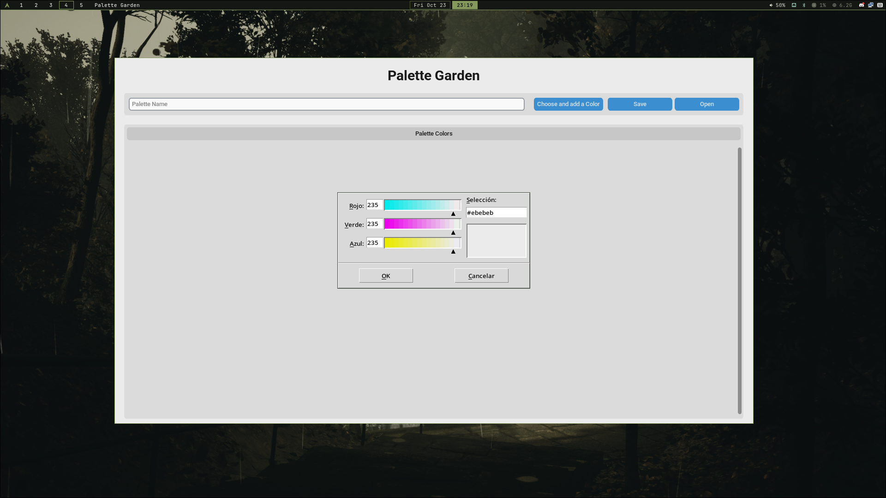
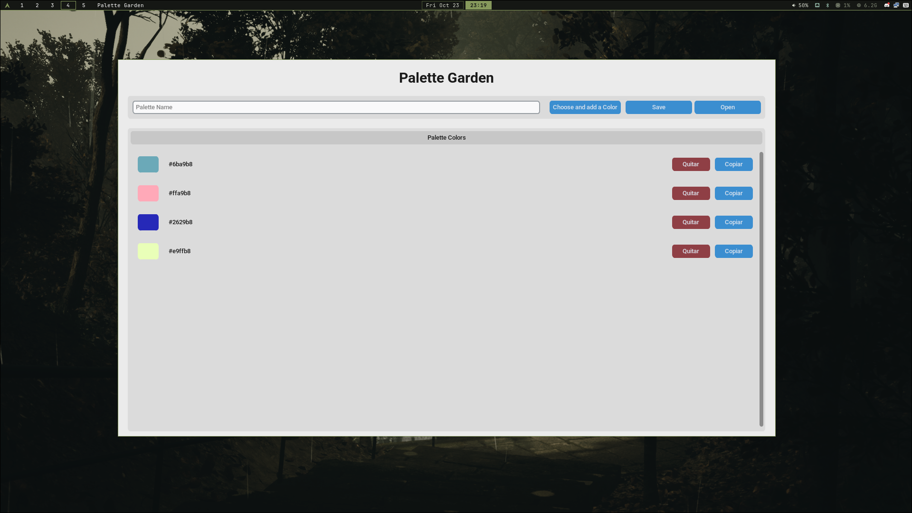

# Palette Garden

A small desktop app for creating and organizing color palettes. Built with Python and CustomTkinter as my first graphical tool.

## Features

- Choose colors with a color picker
- Preview the selected color and its hexadecimal code
- Add and remove colors from a palette
- Copy hexadecimal color codes to the clipboard
- Save and open palettes as JSON files

## Screenshots





## Installation and Usage on Arch Linux

Install Python and Tk:

```bash
sudo pacman -S python tk
```

Clone the repository and enter the project directory:

```bash
git clone https://github.com/hyoodoe/palette-garden.git
cd palette-garden
```

Create a virtual environment and install the dependencies:

```bash
python -m venv .venv
source .venv/bin/activate
pip install -r requirements.txt
```

Run the app:

```bash
python main.py
```
